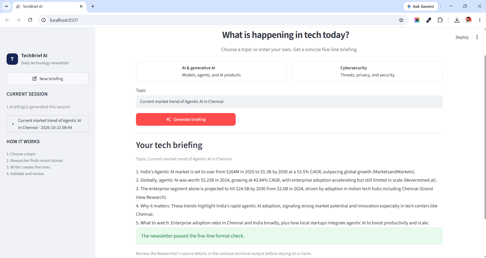

# TechBrief AI

TechBrief AI researches recent technology news and turns it into a concise five-line briefing using a sequential two-agent CrewAI workflow.

## Demo

| Streamlit interface | Terminal interface |
|---|---|
| <video src="https://github.com/user-attachments/assets/cd813a08-62e1-4433-9bee-d0867e525b9f" controls width="100%"></video> | <video src="https://github.com/user-attachments/assets/6836ae8a-b11b-4edf-a098-b69b91a8d5f7" controls width="100%"></video> |

## Screenshot



## Features

- Researcher uses `SerperDevTool` to search for recent technology stories.
- Writer has no tools and receives the Researcher's output through task context.
- Tasks run sequentially with `Process.sequential`.
- A custom date tool helps anchor time-sensitive research.
- A deterministic check validates the five-line output format.
- Streamlit provides suggested topics, custom topic input, execution status, and session history.
- API keys are loaded from a local `.env` file.

## Workflow

1. Researcher finds three distinct, recent stories for the selected topic.
2. Writer receives the research through `context=[find]`.
3. Writer returns five numbered lines: three stories, `Why it matters`, and `What to watch`.
4. The application checks the response format and displays the result.

## Requirements

- Python version supported by the installed CrewAI release.
- OpenAI API key.
- Serper API key from [serper.dev](https://serper.dev/).
- Internet access.

## Setup on Windows

Run these commands from the project folder in PowerShell.

### 1. Create and activate the environment

```powershell
py -m venv .venv
.\.venv\Scripts\Activate.ps1
```

### 2. Install dependencies

```powershell
python -m pip install --upgrade pip
pip install -r requirements.txt
```

### 3. Configure keys

```powershell
Copy-Item .env.example .env
```

Edit `.env` and replace the placeholders:

```env
OPENAI_API_KEY=your_openai_api_key
SERPER_API_KEY=your_serper_api_key
```

Never commit or share `.env`. It is excluded by `.gitignore`.

### 4. Run the CLI

```powershell
python news_crew.py
```

### 5. Run the Streamlit app

```powershell
streamlit run app.py
```

Open the local URL printed by Streamlit, usually `http://localhost:8501`.

## Validation and limitations

The evaluator checks the five-line numbered format; it does not independently fact-check claims. Verify important details against the source URLs shown in the Researcher's verbose output. Session history is temporary and may be lost when the session or application restarts.

CrewAI callback details can vary by version. The interface displays observed callback activity where available, and verbose logs are available in the terminal.

## Project structure

```text
crewai-techbrief-ai/
├── news_crew.py
├── app.py
├── requirements.txt
├── .env.example
├── .gitignore
├── README.md
└── screenshots/
```